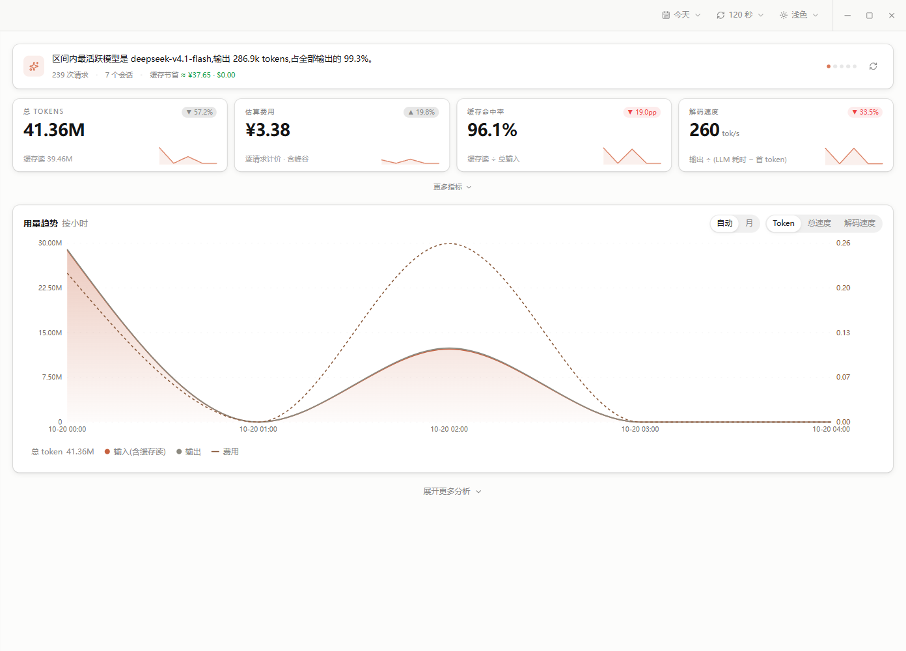
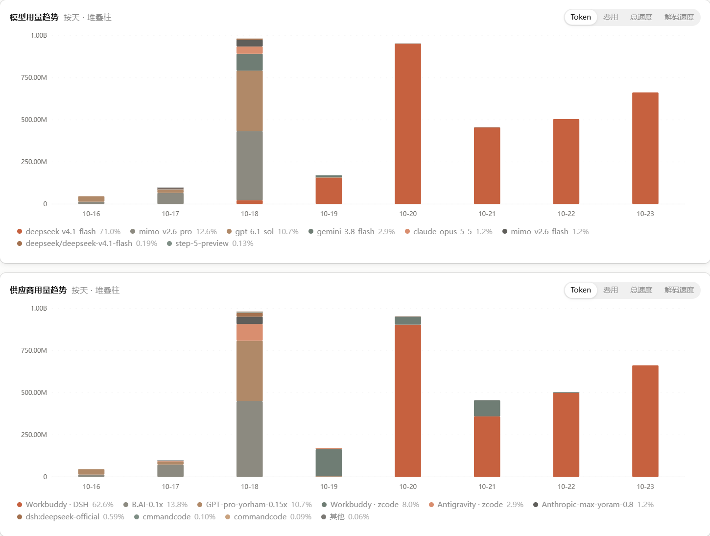
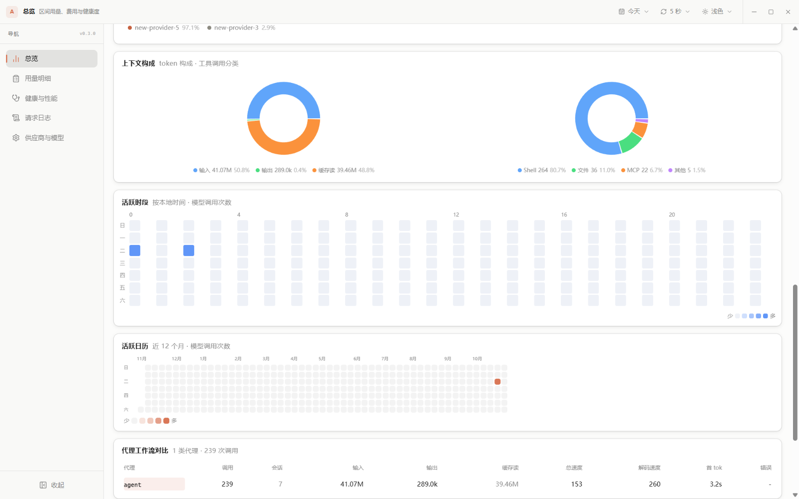
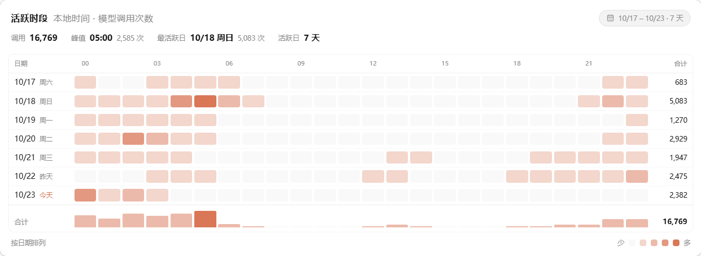
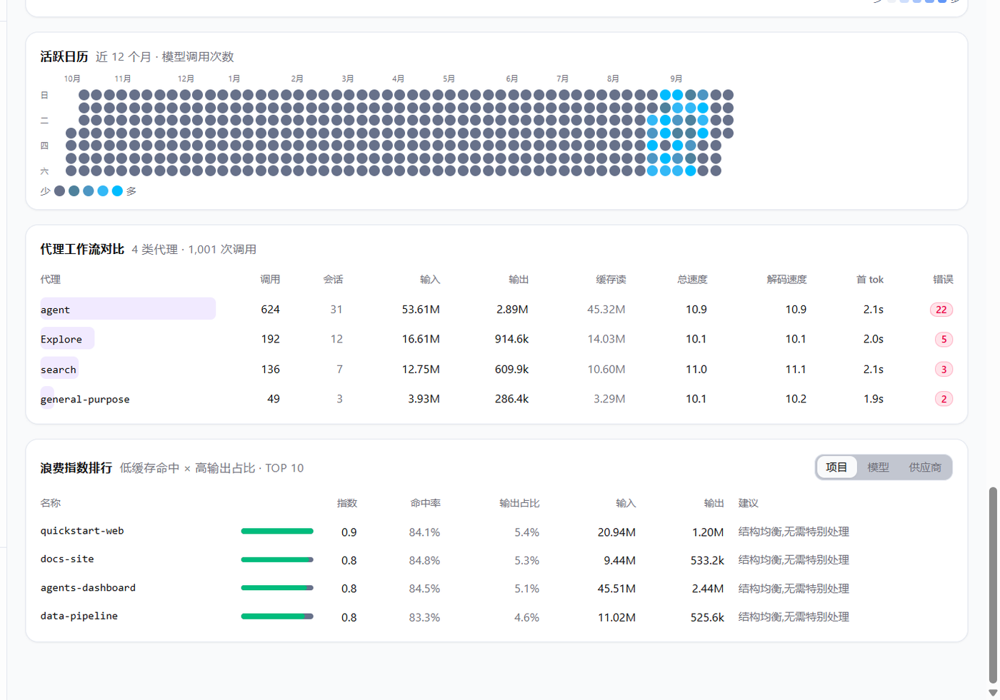
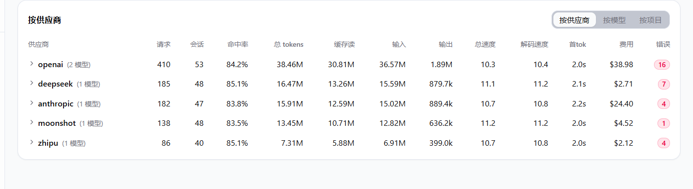
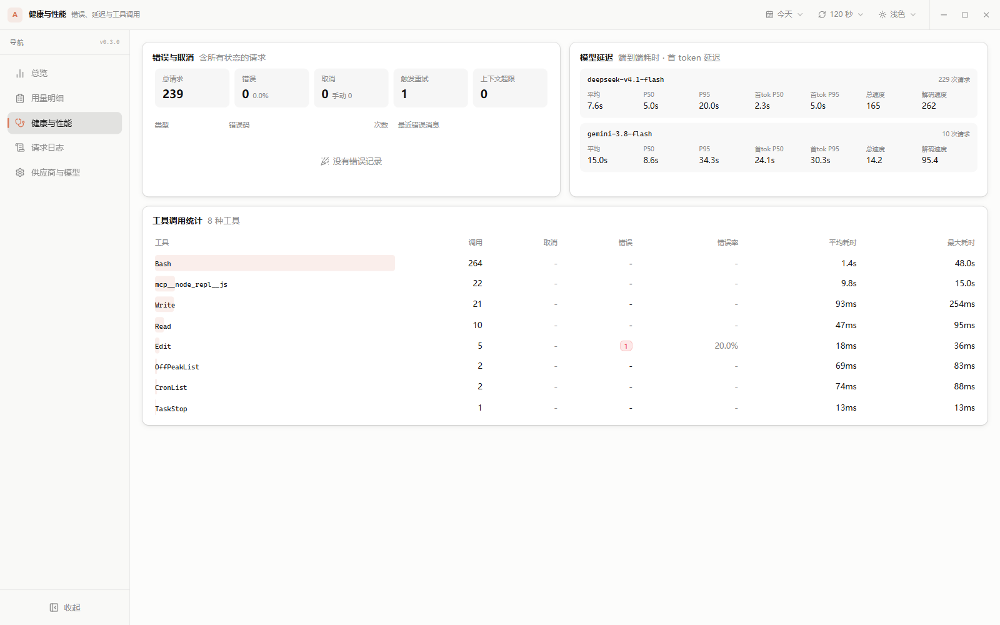
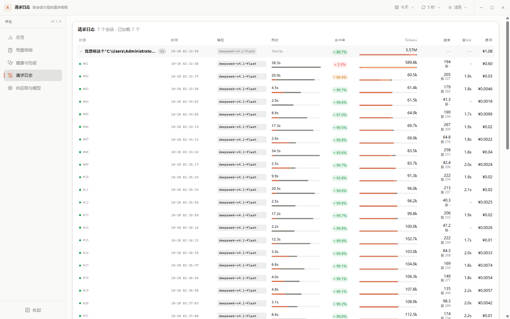
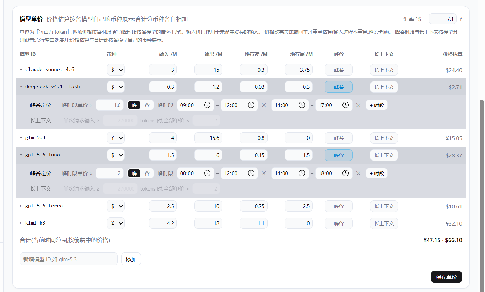

# Agents Dashboard

[](LICENSE)
[](package.json)
[](https://v2.tauri.app/)
[](#安装与运行)

Agents Dashboard 是一个本地优先的 AI 编码代理用量看板：把你本机上 AI 代理的每一次模型调用、工具调用和费用摊开来看清楚——用了多少 token、花在哪、贵在哪、命中率如何、哪里在浪费。数据全部来自本机数据库，只读、不上传。

> **支持 ZCode 与 DSH 两个数据源**：zcode 读取 `~/.zcode/cli/db/db.sqlite`，DSH 读取 `~/.dsh/sessions` 下的会话日志；顶部可切换「全部 / zcode / DSH」，两个源都有用量时默认聚合展示。

## 界面预览

> 以下截图为本机真实数据渲染，数值会随时间变化。截图为 0.3.x–0.4.7；0.4.0 新增顶部「全部 / zcode / DSH」范围切换与行级来源徽章，0.4.3 活跃时段改为日期×小时热力图，0.4.4 加入逐日分布条与分步展开，0.4.5 活跃时段改为总 Token 口径，0.4.6 长区间支持按天/按小时切换并移除按星期，0.4.7 模型/供应商趋势的 Token 与费用改为堆叠柱状图。

### 总览

洞察条（最活跃模型、缓存命中率、费用摘要、解码最快的模型、供应商分布，可点击切换）+ 4 张主指标卡（带迷你趋势线与区间涨跌）+ 可展开的 4 张次指标卡 + 用量趋势（输入/输出/费用）。



### 趋势与构成

按模型、按供应商的堆叠趋势支持 Token / 费用 / 总速度 / 解码速度四种口径切换；Token 与费用为堆叠柱状图（所选范围内用量大的系列在下、小的在上），总速度 / 解码速度为折线。今天 / 昨天按小时分桶，7 天 / 30 天 / 全部按天分桶。悬停柱段查看单个系列名称、用量与该时间桶，悬停 X 轴日期查看该桶全部系列；上下文构成用双环图拆分 token 构成与工具调用分类。





### 活跃时段

单日按 24 小时柱状图展示，多日按日期逐行展开，每行右侧带 Token 条；数值为总 Token（输入 + 输出，缓存读写不重复叠加）。30 天 / 全部默认先显示最近 7 天，可按 7 → 30 → 再 +30 天分步展开，也可一键全部展开；这两个范围还可在「按天 / 按小时」之间切换，按小时为所选范围的 24 小时分布。悬停查看时段 Token 与占比，点击固定详情卡。



### 代理工作流 / 浪费指数

按代理类型对比的调用与耗时、以及按「低缓存命中 × 高输出占比」排序的浪费指数排行（项目 / 模型 / 供应商三个维度）。



### 用量明细

按供应商 / 模型 / 项目三种视角的明细表：请求数、会话数、命中率、各类 tokens、总速度、解码速度、首 token、费用与错误数。请求量与 token 量带组内占比条，token 条按缓存读 / 未命中输入 / 输出分色；供应商行可展开查看其下各模型，表头吸顶。



### 健康与性能

错误与取消统计（按错误类型分组，含错误码与示例消息，429/超时/上下文超限分开计）、按模型的延迟百分位（平均值 / P50 / P95 / 首 token P50、P95）、工具调用统计（调用次数、错误率、平均与最大耗时）。



### 请求日志

按会话分组的请求明细：请求序号、时间、模型、耗时瀑布（首 token + 解码）、命中率、token 构成条、速度、首 token 与费用；支持展开子代理请求与分页浏览，表头吸顶。



### 设置

模型单价表：每个模型可单独设置币种、四项单价、峰谷倍率与长上下文加价，并在右侧实时给出该模型的估算费用。



## 功能特性

- **时间范围**：今天 / 昨天 / 近 7 天 / 近 30 天 / 全部 / 自定义日期区间
- **数据源范围**：全部 / zcode / DSH 三段切换，选择写入 `ui-prefs.json`；同名模型与供应商按来源分行并带徽章
- **无边框标题栏**：自绘拖拽区与最小化 / 最大化 / 关闭按钮，关闭仍然收进系统托盘
- **自动刷新**：5 / 30 / 60 / 120 秒，数据静默替换不闪烁；隐藏到托盘时暂停
- **主题**：浅色 / 深色 / 自动跟随系统
- **总览**：洞察条、4 张主指标卡（迷你趋势 + 区间涨跌）、可展开的次指标卡、用量趋势、按模型与供应商的堆叠柱趋势（Token/费用）、上下文构成双环图、日期×小时活跃热力图（逐日 Token 条 + 分步展开 + 按小时分布）、代理工作流对比、浪费指数排行
- **用量明细**：供应商 / 模型 / 项目三个视角的完整指标表，带占比条与命中率药丸，表头吸顶
- **健康与性能**：错误分组、模型延迟百分位、工具调用统计，标签页徽标直接显示错误数
- **请求日志**：按会话分组的树形明细，请求序号、耗时瀑布与 token 构成条，子代理请求缩进挂在父会话下，按会话分页
- **设置**：逐模型维护币种、四项单价、峰谷倍率与长上下文加价，实时估算费用
- **费用估算**：逐请求计价、按模型分币种、逐模型峰谷与长上下文加价、缓存节省估算（见下文口径说明）
- **系统托盘常驻**：主窗口关闭时隐藏到托盘；隐藏期间暂停刷新与 DSH 索引，单击托盘图标唤回并立即补一次查询
- **单实例保护**：重复启动只会唤起已有窗口，避免多个实例互相覆盖配置

## 数据源

看板同时接入两个本机数据源，顶部「全部 / zcode / DSH」切换范围；默认「全部」，两个源都有用量时洞察条会给出请求与 token 的构成比例。

| 数据源 | 数据位置 | 接入方式 |
| --- | --- | --- |
| zcode | `~/.zcode/cli/db/db.sqlite` | 只读打开原库 |
| DSH | `~/.dsh/sessions/<项目>/<会话>/session[.v4].jsonl.zstd` | 流式解压多帧 zstd，索引到本机 `dsh-index.sqlite` |

- DSH 索引文件：`%APPDATA%\io.github.laomushan.agents-dashboard\dsh-index.sqlite`（macOS 为 `~/Library/Application Support/io.github.laomushan.agents-dashboard/dsh-index.sqlite`）。首次查询建索引（本机 146 个文件约 2 秒），之后按文件大小/修改时间增量更新，10 秒节流。
- 两个源都只读；DSH 的供应商/模型配置由 DSH 自己管理。
- **没有后台服务、计划任务或开机自启**：索引更新只发生在界面查询时；窗口隐藏到托盘后暂停刷新与索引，退出应用后不再有任何活动。
- 聚合口径：请求数、会话数、token、费用直接相加；速度、首 token、延迟分位数按来源分别计算后再展示（同名模型会出现两行并带来源徽章），避免把两个源的耗时混成一个平均值。
- DSH 缺口：日志不提供推理 tokens、缓存写通常为 0、工具取消状态不可辨；首 token 与解码速度按日志里的流式时间戳计算，缺少时间戳的请求不计入解码口径。工具耗时晚于 step 结束时间的结果按未知处理，避免会话隔天恢复时的补发结果污染统计。

## 费用估算口径

费用不是用聚合 token 反推的，而是**逐请求计价后累加**——这样才能正确处理按时间变化的峰谷价与按单次请求输入量触发的长上下文加价。

每个请求的单价档按以下顺序确定：

1. **币种折算**：价格表里的数字按其币种（`$` / `¥`）折算，人民币价按面板里设置的汇率折成美元
2. **峰谷倍率**：主价填的是谷时价，命中该模型配置的峰时段则乘倍率（未启用峰谷的模型完全跳过时段判定）
3. **长上下文加价**：单次请求输入超过阈值时，四项单价整体乘倍率

单请求费用：

```
(输入 − 缓存读) × 输入价
+ 缓存读 × 缓存读价
+ 输出 × 输出价
+ 缓存写 × 缓存写价
```

> ZCode 的 `input_tokens` 是**含缓存命中**的总 prompt（`cache_read` 是它的子集），所以输入价只作用于未命中部分，否则命中部分会被重复计费。

**缓存节省** = `缓存读 × (实际输入价 − 实际缓存读价)`，与计费共用同一套单价（币种、峰谷、长上下文都一致）。

**合计按币种分账**：卡片和单价表里的合计分别给出人民币定价模型与美元定价模型各自的合计（`¥… · $…`），而不是把总额换算一次。

未配置单价的模型按 0 计费，并在卡片和明细表中标注。内置的默认单价仅为示例，请按你的实际价格修改。

## 安装与运行

### 从源码构建（Windows 已验证）

需要 [Node.js](https://nodejs.org) 18+、[Rust 工具链](https://rustup.rs)（`rustup`），以及 Windows 上的 [WebView2](https://developer.microsoft.com/microsoft-edge/webview2/)（Win11 已内置）。

```bash
npm install
npm run dev                       # 开发模式：自动起 vite 并打开桌面窗口
npx tauri build                   # 打包：产物在 src-tauri/target/release/bundle/
```

> Windows 上请在 Git Bash 中执行打包命令。`npm run build` 里的 `RUSTFLAGS=...` 前缀是 bash 语法，在 cmd/PowerShell 下会失败；直接 `npx tauri build` 即可。打包前先关掉正在运行的旧进程，否则文件会因占用而失败。

产物：

- Windows：`bundle/nsis/*-setup.exe`、`bundle/msi/*.msi`
- macOS：`bundle/dmg/*.dmg`、`bundle/macos/*.app`
- Linux：`bundle/appimage/`、`bundle/deb/`

macOS 上未签名、未公证，首次打开若提示「已损坏，无法打开」，这是 Gatekeeper 对未签名应用的隔离拦截（文件本身没坏），执行下面的命令即可：

```bash
xattr -cr "/Applications/Agents Dashboard.app"
```

> macOS 与 Linux 的打包路径沿用 Tauri 默认配置，本项目目前只在 Windows 上完整验证过。

## 发布与自动推送

- 版本号需在 `package.json`、`src-tauri/Cargo.toml`、`src-tauri/tauri.conf.json` 三处保持一致。
- 推送到 `main` 后，`.github/workflows/release.yml` 会读取 `package.json` 的版本：
  - 该版本还没有 Release：在 Windows runner 上构建 NSIS/MSI，并创建 Release，更新日志由 GitHub 自动生成；
  - 已有 Release：只跑一次轻量检查，不重复构建。
- 本机可选安装 post-commit 钩子，让每次提交自动推送 `main`：

  ```powershell
  pwsh -ExecutionPolicy Bypass -File scripts/install-autopush.ps1
  ```

  停用：删除 `.git/hooks/post-commit`。钩子会把每次提交直接推到公开仓库，不想自动推送时删掉即可。
- Release 资产是 Windows 安装包（NSIS `.exe` 与 MSI），未签名，SmartScreen 可能提示。

## 使用说明

### 主窗口

1. **切换时间范围**：标题栏左侧的日期范围下拉，预设或「自定义」在日历中点选起止日期
2. **切换数据源 / 自动刷新 / 主题**：标题栏的「全部 / zcode / DSH」、刷新间隔与主题下拉；切换范围或数据源会立即重新加载
3. **五个标签页**：总览 / 用量明细 / 健康与性能 / 请求日志 / 设置
4. **关闭到托盘**：点窗口关闭按钮隐藏到托盘（暂停刷新与 DSH 索引），单击托盘图标或再次启动应用唤回

### 设置模型单价

1. 打开「设置」标签页
2. 每个模型一行：币种、输入 / 输出 / 缓存读 / 缓存写四项单价（每百万 token），展开行可配置峰谷时段与长上下文加价，右侧给出该模型的估算费用
3. 数字改动**不会逐键实时重算**（避免输入卡顿）：输入框失焦或按回车才重算；点「保存单价」写入配置并全量刷新

单价保存在应用配置目录：

- Windows：`%APPDATA%\io.github.laomushan.agents-dashboard\pricing.json`
- macOS：`~/Library/Application Support/io.github.laomushan.agents-dashboard/pricing.json`

> 应用运行期间不要在外部改这个文件——内存里的配置会在下次保存时把它覆盖掉。改完配置重启应用即可。

## 数据来源与隐私

应用读取两类本机文件，数据库始终**只读**打开，不写入、不上传，也不联网：

| 文件 | 默认路径 | 用途 | 可覆盖 |
| --- | --- | --- | --- |
| ZCode 数据库 | `~/.zcode/cli/db/db.sqlite` | 用量、会话、工具调用统计 | `ZCODE_DB_PATH` |
| ZCode 供应商配置 | `~/.zcode/v2/provider_config.json` | 供应商展示名兜底（只读） | `ZCODE_PROVIDER_CONFIG_PATH` |
| ZCode 旧版配置 | `~/.zcode/v2/config.json` | 仅作旧 provider id 的展示名兜底（只读） | `ZCODE_CONFIG_PATH` |

统计口径：

- `model_usage` 表：每次模型调用一行（模型、各类 token、时间、耗时、状态），只计入 `status = 'completed'` 的请求
- `session` 表：会话标题与项目目录；子代理会话通过 `parent_id` 归属到父会话的项目
- `tool_usage` 与 `part` 表：工具调用次数、耗时与错误率

调试或演示时可以指向别的数据库，不影响真实数据：

```bash
ZCODE_DB_PATH=/path/to/other.db npx tauri dev
```

## 技术栈

- 前端：Vite + React + TypeScript + Tailwind CSS v4 + shadcn 风格令牌 + Recharts + Radix UI
- 后端：Tauri 2 + Rust（rusqlite 只读直查，无 HTTP 层），前端通过 `invoke` 调用
- 桌面能力：单实例保护（`tauri-plugin-single-instance`）、系统托盘常驻守护

## 目录结构

```
src/          前端页面与组件（components/）
src-tauri/    Rust 后端：db.rs（只读连接）、queries.rs（SQL 聚合）、pricing.rs（单价与计费）、
              providers.rs（供应商展示名）、lib.rs（invoke 命令注册）
shared/       前后端共享类型（前端直接引用，Rust 端 types.rs 与之对应）
docs/         截图（模拟数据）与开发计划文档
server/       早期 Web 版 Express 后端的遗留副本，构建不引用
```

## 与上游的差异

本项目基于 [xyq060101/zcode-dashbord](https://github.com/xyq060101/zcode-dashbord) 改造（MIT），保留上游版权声明，改名为 Agents Dashboard 并发布 0.2.0。主要变化：

- **改名与重打包**：名称、标识符、托盘与窗口文案统一为 Agents Dashboard；版本 0.2.0
- **计费重构**：改为逐请求计价，修正缓存命中被重复计费的问题（聚合口径下误差可达 20 倍以上）；新增每模型币种、峰谷倍率、长上下文加价、缓存节省
- **合计分账**：费用与缓存节省按币种分别合计，不再换算成单一币种
- **交互修复**：单价输入不再逐键重算（失焦/回车才重算）、输入框去掉上下箭头、峰谷与长上下文各自独立展开行
- **单实例保护**：重复启动会唤起已有窗口，避免多实例互相覆盖配置
- **界面扩充**：洞察条、浪费指数排行、代理工作流对比、上下文构成双环图、月粒度趋势
- **内置默认单价**：首次启动写入一份默认价格表（glm / kimi 等示例价），首次使用即可看到费用估算

## 已知限制与路线图

- 已接入 ZCode 与 DSH；其他代理客户端的数据库结构与配置格式不同，需要单独适配
- 峰谷时段按本机本地时间判定，暂不支持按供应商时区区分
- 单价表目前是手填；从上游价目页自动拉取价格尚未实现

## 许可证

[MIT](LICENSE)。原始项目版权归 [xyq060101](https://github.com/xyq060101) 所有，本仓库的修改部分版权归 [LAOMUSHAN](https://github.com/LAOMUSHAN) 所有。

